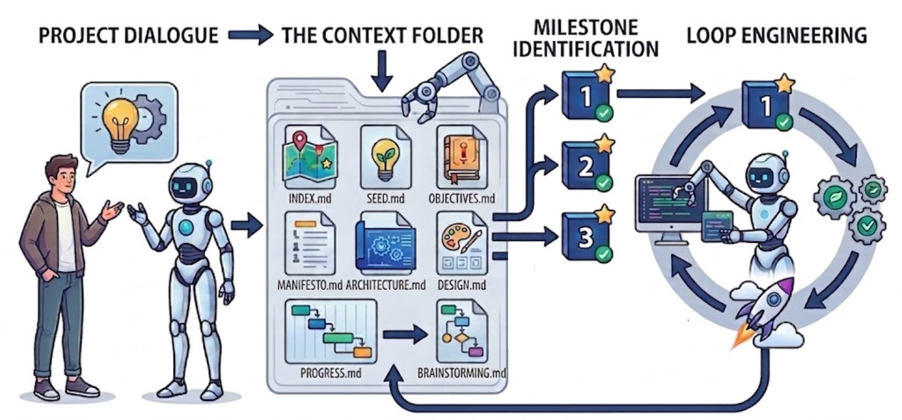

# Kia Context

**A Loop Engineering-friendly Kit of Markdown Files to Maintain Project Context for/by Agents. Nothing More!**

Not a framework. Not a workflow. Not a competitor to [spec-kit](https://github.com/github/spec-kit),
Claude's memory, or your agent's own features. Use all of those. What I provide are the
context docs that you usually ask an agent to write.

There is nothing to learn. You talk to your agent as usual, and it keeps the files up to date.

## Comparison with Others

- [Superpowers](https://github.com/obra/superpowers) → Skills for Development
- [SpecKit](https://github.com/github/spec-kit) → AI-SDLC
- [ClaudeMem](https://github.com/thedotmack/claude-mem) / [`MEMORY.md`](https://code.claude.com/docs/en/memory) → Agent Memory
- **Kia Context → Project Memory**

Kia Context keeps a chronological record of the project in three folders:

- **`genesis/`** records the first moments of the project, at t=0. It shows how the project started.
- **`specs/`** contains the philosophy, design and architecture of the project. It is similar to an SRS
  (Software Requirements Specification).
- **`logs/`** records the live progress of the project. It contains the options you considered, the
  decisions you made, and the milestones that the agent loops over.

Your agent updates these docs while you talk to it. The instructions for the agent are in `AGENTS.md`.

## Quick Install

```bash
curl -sSL https://raw.githubusercontent.com/amirkiarafiei/kia-context/main/install.sh | bash
```


## How to Use



Sorry, I lied. There is one small thing to learn:

1. **Talk to your agent:** Brainstorm features, design the architecture, and make key decisions as usual.
2. **Define milestones:** Make your implementation plan. The agent records each milestone and its acceptance criteria in `PROGRESS.md`.
3. **Loop over the milestones:** Complete them one at a time or in batches, as your workflow requires.

The agent updates the necessary files the way it writes commit messages.

## Context System

There are eight files in `kia-context/`. The agent reads and writes all of them.


| File                    | What it holds                                                                                                               |
| ----------------------- | --------------------------------------------------------------------------------------------------------------------------- |
| `INDEX.md`              | The index to navigate `kia-context/`.                                                                                       |
| `genesis/SEED.md`       | The first prompts that started the project.                                                                                 |
| `genesis/GENESIS.md`    | Why the project exists: what started it, who it is for, and what was intentionally not included at the start.               |
| `specs/MANIFESTO.md`    | What the product is, its rules and boundaries, and what it is NOT.                                                          |
| `specs/ARCHITECTURE.md` | The architecture of the system and software: its tech stack, code structure, methodologies, and so on.                      |
| `specs/DESIGN.md`       | The UI design language, in [DESIGN.md](https://github.com/google-labs-code/design.md) format.                               |
| `logs/PROGRESS.md`      | Chronological logs of the project: what is done so far, and the milestones to complete. Development plans are written here. |
| `logs/BRAINSTORM.md`    | A log of the alternatives considered and the decisions made during human-AI brainstorming sessions.                         |


Additionally, `docs/` holds optional documentation for people: system architecture, software
architecture, deployment, security, authentication, and so on. Your agent writes these documents only when
you ask, usually at the end of the project.

Delete the files that your project does not need. The layout of each file is only a suggestion. Only the
frontmatter is fixed.

## Skills

You can run the skills. The agent can also run them.


|                        | What it does                                                                                                      |
| ---------------------- | ----------------------------------------------------------------------------------------------------------------- |
| `/kia-context-init`    | Creates and initializes the context system. Run it at the start of a project. It also works on existing projects. |
| `/kia-context-help`    | Helps you understand `kia-context`.                                                                               |
| `/kia-context-sync`    | Manually syncs `kia-context` with the latest state of the project, in case the agent forgets to sync.             |
| `/kia-context-migrate` | Migrates your existing files to a newer version of `kia-context`, if one exists.                                  |


## Loop Engineering-friendly

Development plans go into `PROGRESS.md` as milestones. After you add all the plans and milestones to this
file, you can start a loop that iterates over the open milestones until they are done — for example,
[Ralph Loop](https://github.com/snarktank/ralph).

## Installation

The command at the top is the fastest method. To read the script before you run it, clone the repository
and run `./install.sh`. The installer asks one question: which agents work in this repository. You can
safely run it again. It never changes a context file that you already have. Before it replaces one of its
own files, it copies that file to `*.kiacontext-bak`.

```
./install.sh                                    interactive
./install.sh --yes --agents claude,cursor       non-interactive
./install.sh --dry-run                          show what it would do
```

The installer does three things:

1. It creates `kia-context/` and `docs/`.
2. It adds the agent instructions to `AGENTS.md` (and `CLAUDE.md` / `GEMINI.md`) between markers. When you
   run it again, it replaces the instructions and does not add a second copy.
3. It installs four project-scoped skills for the agents that you select.

## 🔌 Supported Agents

The installer puts the four skills in the directory that each vendor documents. The installer always writes
`AGENTS.md`. Every agent added in v0.2 reads this file, so these agents do not need their own instruction
file. Claude Code and Gemini CLI also get `CLAUDE.md` and `GEMINI.md`, because they read those files first.

| Agent | Slug | Skills go in |
| ----- | ---- | ------------ |
| Claude Code | `claude` | `.claude/skills/` |
| Cursor | `cursor` | `.cursor/skills/` |
| Gemini CLI | `gemini` | `.gemini/skills/` |
| Codex | `codex` | `.agents/skills/` |
| GitHub Copilot | `copilot` | `.copilot/skills/` |
| OpenCode | `opencode` | `.opencode/skills/` |
| Qoder | `qoder` | `.qoder/skills/` |
| Kiro | `kiro` | `.kiro/skills/` |
| Hermes Agent | `hermes` | `.hermes/skills/` |
| Antigravity | `antigravity` | `.agents/skills/` |
| Pi | `pi` | `.pi/skills/` |
| Oh My Pi | `omp` | `.omp/skills/` |
| Grok | `grok` | `.grok/skills/` |

`.agents/skills/` is a shared convention. It does not belong to one vendor. Codex and Antigravity use it as
their primary directory. If you select both, the installer installs one copy, not two.

Hermes, Pi and Oh My Pi also read `.agents/skills/`. But the installer writes their skills to the directory
that each vendor documents, so each of these agents gets its own copy. You can move them to the shared
directory if you want.

**Hermes and Pi ignore project skills until you trust the project.** The installer tells you this when you
select one of them. For Hermes, run `hermes skills trust`. Pi asks you on the first run. Oh My Pi does not
have this step.

For a different agent, select **Other** and give a path, or use `--skills-dir`.

## Updating

To update, run the installer again. This is the full update procedure, and it is safe:

| What | What happens when you run it again |
| ---- | ------------------- |
| `kia-context/`, `docs/` | not changed — these files contain your project, not ours |
| the `AGENTS.md` block | replaced **in place**; the previous copy is kept at `AGENTS.md.kiacontext-bak` |
| the skills | replaced; the previous copy is kept at `SKILL.md.kiacontext-bak` |

The installer writes a backup only when the content will change. If nothing changed, it writes no backup.
**The installer never overwrites an existing backup.** It names later backups `.kiacontext-bak.1`,
`.kiacontext-bak.2`, and so on.

This is important. The first backup contains your changes. With only one backup file, the next update
could replace your changes with an old copy of our file. You can delete the backups after you examine them.

Sometimes the markers around the block become damaged. For example, one marker is deleted, or the block
is pasted twice. Then the installer **does not change that file**, and it tells you what to repair. If it
rewrote the file from a damaged marker, it could delete your text around the block.

The installer reports a file as installed only when it wrote that file. If any part fails, the installer
tells you and exits with a non-zero code. It does not show a green tick.

Sometimes the structure of the harness changes. Then your context files must move. Only an agent can do
this correctly, because these files are prose, not a schema. The installer reads the version of this
project (`harness:` in `kia-context/INDEX.md`). If the project is behind, the installer tells you to run
`/kia-context-migrate`.

That skill applies only the changes since your version. It moves your content and does not write it again
from the start. It updates the version stamp **last**, so a migration that is not complete never looks
complete.

## Naming Philosophy

**Kia** as in Amirkia. Also as in the car.

Kia makes cars that are good, but not the best or the most expensive. Nobody buys a Kia and expects a
Ferrari, and nobody regrets the purchase. It starts every morning, it does its job, and its owners are
satisfied. It does not try to be a Rolls-Royce.

Kia Context is the same. It does not compete with [spec-kit](https://github.com/github/spec-kit) or
[Superpowers](https://github.com/obra/superpowers). Those projects try to do more. Kia Context is a good way
to maintain project context. It is simple, easy to understand, and enough.

Nothing more.

## Layout of this repository

```
install.sh          the installer
_template/          the markdown files it copies, plus AGENTS.harness.md
skills/             the four skills
tests/              update and migration scenarios — ./tests/update-scenarios.sh
```

License: MIT.
